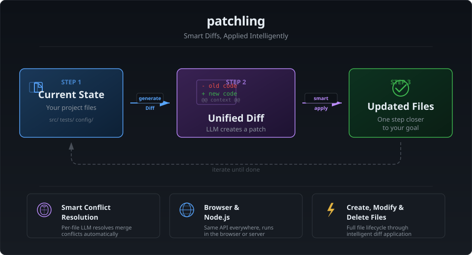

# patchling

<p align="center">
  
</p>

> _Formerly **gptdiff-js**._

**Natural-language code transformation, browser-first.** Hand patchling an in-memory `{ path: content }` file map plus a plain-English goal; **`generateDiff`** returns a unified git diff, and **`smartapply`** melds that diff into your source — even when `git apply` would reject it (drifted lines, fuzzy hunks, renames, new files, deletions). It's a bounded primitive you embed in your own app, not an open-ended coding agent. Wired to [NanoGPT](https://nano-gpt.com) for completions (including "Sign in with NanoGPT" OAuth PKCE).

Everything runs in the browser (and in Node 18+): no filesystem, no build step, zero runtime dependencies. The diff engine is a faithful port of the [Python patchling](https://github.com/255BITS/patchling-py) (formerly gptdiff); it operates on an in-memory file map instead of a directory on disk.

See it in action: **[patchling.app](https://patchling.app)** (live demo on the homepage) · **[live browser demos →](https://255bits.github.io/patchling-examples/)**

> **The family** —
> [**patchling.app**](https://patchling.app) (project home + live demo) ·
> **patchling** (this package — the browser/Node runtime, [npm](https://www.npmjs.com/package/patchling)) ·
> [**patchling for Python**](https://github.com/255BITS/patchling-py) (library + CLI, [PyPI](https://pypi.org/project/patchling/)) ·
> [**nanoodle.com**](https://nanoodle.com) (visual AI workflow editor built on it)

```js
import { generateDiff, smartapply, buildEnvironment } from 'patchling';

const files = { 'greet.py': 'def greet():\n    print("hello")\n' };

// 1. Ask the model for a unified diff
const diff = await generateDiff(buildEnvironment(files), 'Say goodbye instead of hello');

// 2. Apply it with AI-powered conflict resolution
const updated = await smartapply(diff, files);
console.log(updated['greet.py']);
```

## Install / run

```bash
npm install patchling
```

```js
import { generateDiff, smartapply } from 'patchling';
```

**Browser, no build step** — it's zero-dependency ESM, so a CDN import works directly:

```js
import { generateDiff, smartapply } from 'https://esm.sh/patchling';
```

**Run from source** — point an import at `src/index.js`, or open `index.html` from a static server:

```bash
npx serve .        # then visit the printed URL and try the demo
npm test           # run the unit suite (Node's built-in test runner)
npm run test:live  # hit NanoGPT for real (requires env vars, see below)
```

The browser demos explicitly use `xiaomi/mimo-v2.6-flash` for diff generation
and repair. The landing-page picker also pins `xiaomi/mimo-v2.6-pro` and
`z-ai/glm-5.3-flash`. These IDs, capabilities, and prices were checked against
[NanoGPT's public catalog](https://nano-gpt.com/api/v1/models?detailed=true)
on 2026-10-13 (re-checked 2026-10-21, when the default `deepseek/deepseek-v4.1-flash-1017` was added); the offline snapshot is in `test/fixtures/demo-models.json`.
The decision demo requests MiMo's supported `none` reasoning effort.
Library environment defaults below are independent of the demo choices.

## Configuration

Configuration comes from environment variables (Node) or `setEnv(...)` overrides (browser). OAuth sign-in sets the API key override for you.

| Variable | Purpose | Default |
| --- | --- | --- |
| `GPTDIFF_LLM_API_KEY` | NanoGPT API key (`sk-nano-…`) | — (required for live calls) |
| `GPTDIFF_LLM_BASE_URL` | OpenAI-compatible base URL | `https://nano-gpt.com/api/v1/` |
| `GPTDIFF_MODEL` | Model id | `deepseek/deepseek-v4.1-flash-1017` |
| `GPTDIFF_FILTER_MODEL` | Cheap model for `filterRelevant` | `xiaomi/mimo-v2.6-flash` |

```js
import { setEnv } from 'patchling';
setEnv('GPTDIFF_LLM_API_KEY', 'sk-nano-…'); // browser, no process.env
```

## Sign in with NanoGPT (OAuth 2.0 + PKCE)

`src/oauth.js` implements the [NanoGPT OAuth PKCE flow](https://nano-gpt.com/blog/sign-in-with-nanogpt-oauth-pkce) using Web Crypto. In a browser:

```js
import { registerClient, beginSignIn, completeSignIn } from 'patchling/oauth';

// On page load — finishes the redirect and stores the access token as
// the GPTDIFF_LLM_API_KEY override automatically:
await completeSignIn();

// To start sign-in (clientId from a one-time dynamic registration):
const { client_id } = await registerClient({
  clientName: 'My App',
  redirectUri: location.origin + location.pathname,
});
await beginSignIn({ clientId: client_id }); // redirects to NanoGPT
```

Low-level helpers are also exported: `generatePkce`, `buildAuthorizeUrl`, `exchangeCodeForToken`, `generateCodeChallenge`.

## API

### `generateDiff(environment, goal, opts?) → Promise<string>`
Builds the prompt, calls the LLM, and returns the unified diff extracted from the ` ```diff ` block(s) of the response.

- `opts.model`, `opts.temperature`, `opts.maxTokens`, `opts.apiKey`, `opts.baseUrl`, `opts.prepend`, `opts.images`
- `opts.onToken` — `(text) => void` streaming callback. When provided, the completion is streamed (SSE) and called once per token as it arrives; the returned promise still resolves to the extracted diff. Tokens are the raw model output, which may include prose around the ` ```diff ` block.
- `opts.callLlm` — inject a custom/mock completion client (used heavily in tests).
- `opts.onUsage` — optional callback invoked with `{ promptTokens, completionTokens, totalTokens }` after the LLM call completes, so callers can surface cost/usage without changing the `Promise<string>` return type.

### `filterRelevant(files, task, opts?) → Promise<Result>`
Opt-in pass for a large file map. Each candidate file is sent with the task to a cheap model that answers `is this file relevant to the task? yes/no`. `result.files` is the `yes` map, in input order, with the original contents. Hand that to `generateDiff`. `smartapply` still takes the full map, so files the diff never mentions are left as they were.

```js
import { filterRelevant, buildEnvironment, generateDiff, smartapply } from 'patchling';

const result = await filterRelevant(files, task, {
  // model: 'xiaomi/mimo-v2.6-flash',       // GPTDIFF_FILTER_MODEL, else this default
  concurrency: 8,                           // max in-flight calls
  // cache: null,                           // omit for a fresh in-memory cache; a path string persists it
  // maxBytes: 200000,                      // 0 or null disables
  // maxTokens: 12000,                      // input-token cap; 0 or null disables
  // onOversize: 'truncate',                // include | exclude | truncate
  // onBinary: 'exclude',                   // include | exclude | truncate
  onDecision(d) { console.log(d.path, d.decision); },
});
const diff = await generateDiff(buildEnvironment(result.files), task, { model });
const next = await smartapply(diff, files);
```

- `opts.model`, `opts.apiKey`, `opts.baseUrl` — same key and base URL resolution as `generateDiff` (`GPTDIFF_LLM_API_KEY`, `GPTDIFF_LLM_BASE_URL`). The model falls back to `GPTDIFF_FILTER_MODEL`, then `xiaomi/mimo-v2.6-flash`.
- `opts.concurrency` — at most this many classifications in flight (default 8).
- `opts.cache` — a `RelevanceCache`, a `{ get, set }` object, or a filesystem path (Node writes `{ version: 1, entries }` atomically; a corrupt file is ignored). Omit it, or pass `true`, for a fresh in-memory cache used only by this call. `null` and `false` turn caching off. `createMemoryCache()` builds another memory cache you can share. The key is the SHA-256 of the length-prefixed classification inputs. Each field is written as its UTF-8 byte length, a colon, the bytes, and a newline, in this order: prompt version (`3`), model, output-token limit, the reasoning effort actually sent (`""` when that parameter was omitted or rejected), task, file path, mode (`full`, `truncated`, or `binary`), the preview note (or `""`), and the body that was sent. A later lookup tries the configured effort first, then the empty effort. A full file and a preview truncated to the same bytes do not share a key. Each path is its own decision, including paths with identical contents. A cache read failure is a miss. A cache write failure is logged and the run continues. Fallback and error decisions are not stored.
- `opts.maxBytes` — UTF-8 size cap (default 200000). `opts.maxTokens` — input-token cap (default 12000; `ceil(code points / 4)`, so a surrogate pair is one code point). `0` or `null` disables either limit. Token truncation keeps the first `maxTokens * 4` code points. Byte truncation stays on a UTF-8 code-point boundary.
- `opts.onOversize` and `opts.onBinary` — `include` (keep, no model call), `exclude` (drop, no model call), or `truncate` (ask about a preview). Defaults are `truncate` and `exclude`. A `yes` on a truncated preview still forwards the original text in `result.files`. An included binary file keeps the original bytes.
- `opts.ignore` — lockfiles and generated paths are excluded with `skippedReason: "ignored"`. Matching is case-insensitive. `**` crosses directories and `*` does not. `false` classifies every path. An array replaces the default list. The canonical list is `DEFAULT_IGNORE_PATTERNS`: `**/package-lock.json`, `**/yarn.lock`, `**/pnpm-lock.yaml`, `**/bun.lock`, `**/bun.lockb`, `**/npm-shrinkwrap.json`, `**/Cargo.lock`, `**/Gemfile.lock`, `**/poetry.lock`, `**/Pipfile.lock`, `**/composer.lock`, `**/go.sum`, `**/uv.lock`, `**/pdm.lock`, `**/flake.lock`, `**/pubspec.lock`, `**/packages.lock.json`, `**/Package.resolved`, `**/*.min.js`, `**/*.min.mjs`, `**/*.min.css`, `**/*.map`, `**/dist/**`, `**/build/**`, `**/.next/**`, `**/coverage/**`, `**/__pycache__/**`, `**/*.pyc`, `**/*.pyo`, `**/*.generated.*`. The same list is in `test/fixtures/parity/relevance.json`.
- `opts.maxOutputTokens` — completion cap (default 1024). The call also sends `reasoning_effort: "low"` so a reasoning model does not spend the whole budget before the yes/no. A 4xx that names that parameter is retried once without it. An empty answer is an error.
- `opts.retries` — extra attempts after a timeout, an HTTP 5xx (including 503), or a billing-reservation error (default 2), with exponential backoff.
- `opts.onDecision` — called as each file finishes, in completion order. `result.decisions` stays in input order.
- `opts.callLlm` — inject a mock client.

Each decision is `{ path, decision, reason, raw, tokens, promptTokens, completionTokens, cached, skippedReason, error }`.

- `decision` is `"yes"` or `"no"`. After `<think>` / `<thinking>` blocks are stripped, the decision is a leading standalone `yes` or `no` (quotes, markdown bold, backticks, and an `Answer:` or `Decision:` prefix are wrappers, including when a reason follows, as in `**no** unrelated`). Any other wording, including a negated "no" later in the sentence, is malformed: the file is included, `failedOpen` is true, and the judgment is not cached. An empty answer, a non-string message content, and a thrown call do the same. `error` is set when the call throws or the answer is empty. `result.failedOpen` counts those files, and `formatFilterSummary` includes that count.
- Options are camelCase. Every patchling-py keyword in snake_case (`on_binary`, `max_bytes`, `skip_patterns`, `max_attempts`, `retry_backoff`, `sleep`, ...) throws a `TypeError` before any model call, naming the JS option: `skip_patterns` is `ignore`, `max_attempts: n` is `retries: n - 1`, `retry_backoff: s` (seconds) is `retryBaseMs: s * 1000`, and `sleep` is not supported in JS (pass `retryBaseMs: 0` in tests).
- `skippedReason` is `"binary"`, `"oversize"`, `"truncated"`, `"ignored"`, or `null`.
- `tokens`, `promptTokens`, and `completionTokens` are `0` when no model call was made. `reason` is a string. `failedOpen` is true only when the file was included without a definitive yes/no.
- `result.billedTokens` sums token counts for decisions that were not cache hits. Identical contents at different paths are separate calls.
- `buildEnvironment(files, { decisions })` keeps only `"yes"` paths. Passing the decisions array itself does the same. With no second argument, every file is included. `buildEnvironment(result.files)` is the same set.

Python (`filter_relevant` in [patchling-py](https://github.com/255BITS/patchling-py)) returns the same result. Its fields are snake_case: `max_bytes`, `max_tokens`, `on_oversize`, `on_binary`, `skipped_reason`, `prompt_tokens`, `completion_tokens`, `failed_open`. Prompt version 3, the prompt text, the cache-key encoding, the ignore list, and the code-point token estimate are the shared contract in `test/fixtures/parity/relevance.json`. The whole byte payload is validated as UTF-8. A leading BOM (U+FEFF) is kept. A truncated trailing sequence keeps its valid prefix only when the bytes present are a legal partial character (`0x61 0xC3` and `0x61 0xE0 0xA0` are `"a"`). A lead that cannot start a character (C0, C1, F5-FF), a continuation outside 80-BF, or a second byte outside its range (E0 is A0-BF, ED is 80-9F, F0 is 90-BF, F4 is 80-8F) takes the binary path, and so does any other invalid byte. Ignored paths are excluded before those bytes are decoded. A response that is not a chat-completion envelope, including non-string message content, fails that file open and is not cached.

A pallets/flask labeling pass has been described as recall 1.0 for `xiaomi/mimo-v2.6-flash`, with the filter using about 0.8× the tokens of a full-context read. Those figures are **UNVERIFIED**.

### `smartapply(diffText, files, opts?) → Promise<{ path: content }>`
Applies a diff to an in-memory file map with per-file, LLM-assisted conflict resolution (runs files concurrently). Handles creation, modification, and deletion; `<think>…</think>` and reasoning preambles are stripped automatically. Returns a **new** map; deleted files are omitted.

- `opts.model`, `opts.apiKey`, `opts.baseUrl`, `opts.maxTokens`
- `opts.onToken` — `(text, path) => void` streaming callback for LLM-resolved files. Files stream concurrently, so calls for different files interleave; use the `path` argument to demultiplex. Files applied by the deterministic fast path emit no tokens.
- `opts.callLlmForApply` — inject a custom/mock single-file applier.

### `applyDiff(files, diffText) → { changed, files }`
Deterministic, no-LLM patch application (the strict "basic" applier). `changed` is `true` iff something was created, modified, or deleted; `files` is the updated map (equal to the input on failure — no partial writes).

### Other exports
`parseDiffPerFile`, `buildEnvironment`, `filterRelevant`, `RelevanceCache`, `createMemoryCache`, `parseRelevanceAnswer`, `isBinaryContent`, `isIgnoredPath`, `countTokens`, `formatFilterSummary`, `dumpDecisions`, `PROMPT_VERSION`, `colorCodeDiff`, `swallowReasoning`, `stripBadOutput`, `extractDiffBlocks`, `callLlm`, `resolveApiKey`, `resolveBaseUrl`, `getEnv`, `setEnv`, and the `oauth` namespace.

## Differences from the Python package

- **No filesystem.** `applyDiff`/`smartapply` take and return a `{ path: content }` map rather than reading/writing a project directory.
- **Scope.** Only `generateDiff` + `smartapply` (and their dependencies) are ported — not the Python package's CLIs (`patchling`, `patchling-apply`).
- **Dependency injection** replaces Python's `monkeypatch`: pass `callLlm` / `callLlmForApply` to test without a network.
- **`fetch` + Web Crypto** replace `openai`/`requests`/`tiktoken`. Relevance token counts use the same characters/4 estimate Python uses when tiktoken is absent. A disk-backed `RelevanceCache` is Node-only; the browser keeps the in-memory cache.

## License

MIT
